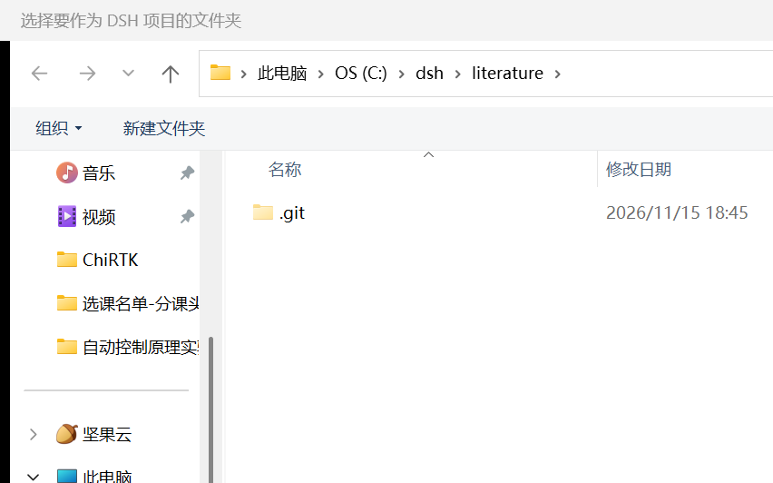
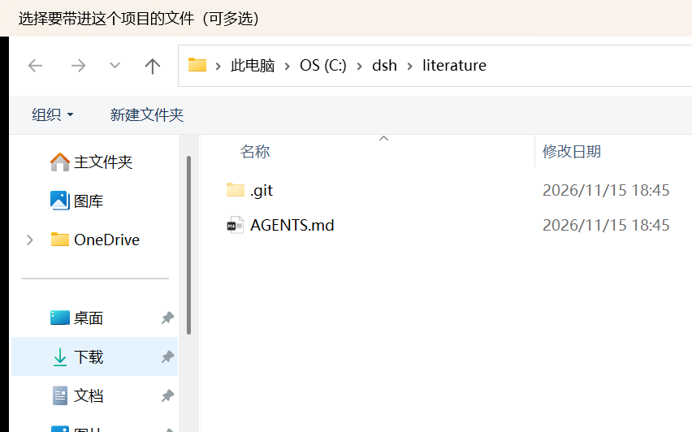

# dsh-project-desk · 项目工作台

> 把「项目」真正搬进 DeepSeek Harness 的 Web 界面：一个名字就能建项目，点开就能改项目指令、挂载要带进每次对话的文件。

[](LICENSE)


---

## 它解决什么问题

在 DSH 里，「项目」本质上是**一个目录**，项目级提示词本质上是**项目根目录的 `AGENTS.md`**。
官方没有「点项目名 → 编辑这个项目的整体 prompt 和包含文件」的界面 —— 想加项目背景，只能自己开资源管理器找文件、手写 Markdown。

这个插件把这条链路搬进 Web UI，而且**不发明第二套存储**：

| 你想要的东西 | 插件实际写入的位置 |
| --- | --- |
| 项目基础指令 / 整体 prompt | `<项目>/AGENTS.md`（真实文件，DSH 自带注入链路会读它） |
| 「把这几份文件当作背景」 | 同一个 `AGENTS.md` 末尾的受管段里的一份路径清单 |

也就是说：不用插件也能看到、能改、能进 git；插件只是让你**不用离开网页**。

## 功能

- **新建项目**：填个名字 → 自动建 `<父目录>/<名字>` 文件夹、写一份首版 `AGENTS.md`、注册成 DSH 工作区，并自动打开该项目的新对话。
- **接管已有文件夹**：硬盘上已有的目录，选一下就能变成 DSH 项目（不移动、不复制、不删除任何文件；只在缺 `AGENTS.md` 时补一份）。父目录不存在会自动创建。
- **编辑项目指令**：右侧大页面直接编辑 `AGENTS.md`，带 64 KB 字节预算提示、`mtime` 冲突保护（别处的改动不会被你无声覆盖）。
- **挂载文件**：点「选择文件…」弹 **Windows 原生通用对话框**（资源管理器同款：面包屑、左侧常用位置、可多选）；选项目外的文件会先复制进项目再挂载。也可以直接勾选文件树，或一步「新建文件并挂载」。
- **自动跟随文件变化**：往项目文件夹里放/删文件，工作合约 2 秒自动刷新；切回浏览器标签时立刻同步，不需要手动点刷新。
- **零运行时依赖、无需构建**：host 半区是普通 ESM，client 半区是手写的单文件 bundle。

### 截图

新建项目页与「选择要作为 DSH 项目的文件夹」（Windows 通用对话框，带 DPI 适配）：



「选择要带进这个项目的文件」（可多选）：



## 安装

前置：DSH 0.2.x（`dsh --version`），Node.js ≥ 22。

1. 把整个 `dsh-project-desk` 目录放到 `~/.dsh/plugins/dsh-project-desk`
   （Windows：`C:\Users\<你>\.dsh\plugins\dsh-project-desk`）。

2. 在你的 profile 目录（如 `~/.dsh/profiles/web`）里加本地依赖：

   ```powershell
   pnpm add "file:../../plugins/dsh-project-desk"
   ```

3. 在该 profile 的 `package.json` 里，把 `"dsh-project-desk"` 追加到 `dsh.profile.bundles` 数组末尾：

   ```json
   {
     "dsh": {
       "profile": {
         "bundles": ["...", "dsh-project-desk"]
       }
     }
   }
   ```

4. 重启 `dsh web`。侧栏出现 **「项目」** 图标即安装成功。

   ```powershell
   dsh web --no-open --port 3080
   ```

> 只改了 client 半区时通常刷新页面（Ctrl+F5）即可生效；改了 host 半区（`lib/index.js`）需要重启 `dsh web`。

## 使用

1. 侧栏底部点 **「项目」** → 打开项目工作台。
2. 打开后右侧默认就是整块的 **新建项目** 页：
   - 「项目名称」+「父目录」（默认 `~\DSH-Projects`，若本机存在 `C:\dsh` 则默认用它）
   - 「首版 AGENTS.md」可留空（空白模板），也可以直接写这个项目的背景与约定
   - 点「创建项目」→ 建目录、写 `AGENTS.md`、注册工作区，并自动打开新对话
   - 想接管已有目录：点「用已有文件夹…」→ 选目录 → 「设为此项目」
3. 选左侧项目卡片 → 右边直接改 `AGENTS.md` → 保存。**下一次在该项目新开对话时生效。**
4. 挂载文件：点「包含文件（挂载）」里的 **「选择文件…」** →
   - 项目内文件：按相对路径写进受管段
   - 项目外文件：先复制一份进项目根目录再挂载（同名同内容会复用，不会产生 `(1)` 副本）
   - 也可以勾选文件树，或输入框 +「新建文件并挂载」（如 `notes.md`、`data/records.jsonl`）

挂载后的 `AGENTS.md` 末尾会多出这样一段（插件只维护这一段，自己别手改它）：

```markdown
<!-- project-desk:start -->
## 项目文件（Project Desk 自动维护，请勿手改本段）

回答前先读下面这些文件，把它们当作本项目的既有背景：

- `data/records.jsonl`
- `notes/饮食原则.md`
<!-- project-desk:end -->
```

## 配置

在 profile 的插件配置里可覆盖（`cordis.patch.yml` 中该 bundle 的 `config`）：

| 字段 | 默认值 | 说明 |
| --- | --- | --- |
| `projectsRoot` | 已存在的 `~/DSH-Projects`，否则已存在的 `C:\dsh`，再否则 `~/DSH-Projects` | 新建项目的默认父目录（不存在会自动创建） |
| `gitInit` | `false` | 是否执行 `git init`（只有「从项目子目录开对话还想读到项目根 AGENTS.md」时才需要） |
| `instructionsFileName` | `AGENTS.md` | 项目基础指令文件名 |

## HTTP API（host 半区）

所有路由都在 `/project-desk/api/*` 下，仅监听本机回环；写接口要求 `content-type: application/json`，且 `Origin`（若有）必须与 `Host` 一致。

| 方法 | 路径 | 说明 |
| --- | --- | --- |
| GET | `/state` | 项目列表（来自工作区注册表）+ 默认值 |
| GET | `/project?dir=<abs>` | 单个项目：`AGENTS.md` 内容 / mtime、文件树、已挂载清单 |
| POST | `/create` | 建目录 + 写 `AGENTS.md` + 注册工作区 |
| POST | `/register-existing` | 接管已有文件夹成项目（补 `AGENTS.md`、可选 `git init`、注册工作区） |
| POST | `/save-instructions` | 保存 `AGENTS.md`（`expectedMtimeMs` 不匹配返回 409） |
| POST | `/mount` | 挂载 / 取消挂载一个项目文件 |
| POST | `/new-file` | 在项目里新建一个空文件（用于「新建 + 挂载」） |
| POST | `/import-files` | 把选中的文件接入项目（项目外先复制进来）并挂载 |
| POST | `/pick-files` | 弹出系统原生文件选择框（host 本机桌面），返回绝对路径 |
| POST | `/pick-folder` | 弹出系统原生文件夹选择框（接管已有文件夹用） |

## 工作原理 / 设计取舍

- **不另建数据库**：项目 = DSH 工作区（`ctx.workspaceRegistry`），指令 = `<项目>/AGENTS.md`，挂载清单 = 该文件里的受管段。所以插件删掉后，项目文件和注入链路照常工作。
- **指令走 DSH 原生链路**：DSH 的 `@deepseek-ai/dsh-agent-instructions` 会从项目根到 cwd 逐层收集 `AGENTS.md` / `CLAUDE.md` / `*.local.md`，单链预算 65536 字节。插件只是换个好用的编辑入口。
- **挂载不是把内容塞进上下文**：写进去的只是路径清单；模型看到清单，需要时才去读文件，所以不会无谓占用上下文预算。
- **原生对话框**：`lib/picker.ps1` 直接 COM 互操作 `IFileOpenDialog`（CLSID `DC1C5A9C-E88A-4dde-A5A1-60F82A20AEF7`），文件夹模式加 `FOS_PICKFOLDERS`，弹窗前 `SetProcessDPIAware()` 保证高 DPI 清晰。
- **安全**：host 路由做回环校验（`Host` / `Origin`），写文件走临时文件 + `rename` 原子替换，保存接口带 `mtime` 乐观锁。

## 常见问题

**Q：「项目边界」/ `.git` 到底管什么？**
DSH 找项目根时，从当前 dialog 的 cwd 逐层向上找第一个带 `.git` 的目录；**找不到就把 cwd 自己当项目根**。所以：在项目根目录开对话，没有 git 也能读到 `AGENTS.md`；只有「在项目内的子目录开对话、却想读到项目根的 `AGENTS.md`」时，`.git` 这个标记才起作用。插件默认不建 git 仓库，需要时把 `gitInit` 打开或用外部 API 显式传 `true`。

**Q：挂载的文件会跟着项目进 git 吗？**
只写路径进 `AGENTS.md`；文件本身在不在 git 里取决于项目自己的 `.gitignore`。

**Q：`dsh web` 跑在远程主机上能用吗？**
可以，但「选择文件…」的对话框会弹在**主机**的桌面上，不是浏览器的桌面。

**Q：双击取消/关闭对话框会报错吗？**
不会，一律按「没选」处理。

## 已知限制

- 只处理已存在的目录（新建项目会自动创建父目录）；删除项目请用资源管理器 —— 插件不删任何文件。
- 项目列表来自 DSH 工作区注册表，插件不提供删除/重命名工作区，避免误删。
- `AGENTS.md` 的受管段由插件维护，手改会被下一次挂载覆盖。
- 名称校验沿用 Windows 规则（禁 `< > : " / \ | * ?`、不以点或空格结尾、不是 `CON`/`PRN` 等保留名）。

## 开发

```
dsh-project-desk/
  package.json          # dsh.bundle.patch / dsh.client.platform 等清单
  cordis.patch.yml      # 把插件挂到 host 平面：- id: project-desk / name: dsh-project-desk
  lib/index.js          # host：HTTP 路由、文件读写、工作区注册、原生对话框
  lib/client.js         # client：手写 UMD-ish bundle（window.__ModuleLoader__.load）
  lib/picker.ps1        # IFileOpenDialog 的 PowerShell + C# 互操作实现
  assets/               # 截图
```

- 零构建：改 `lib/client.js` 后刷新页面即可；改 `lib/index.js` 需重启 `dsh web`。
- 依赖：仅 `@deepseek-ai/cordis`（peer）；运行时不需要任何 npm 依赖。
- 编码：`picker.ps1` 必须 UTF-8 **带 BOM**（Windows PowerShell 5.1 会按 GBK 解析无 BOM 文件）。

## English

**dsh-project-desk** – a DeepSeek Harness (DSH) web plugin that turns "projects" into a first-class UI object:

- create a project from a name (makes the folder, writes `AGENTS.md`, registers a DSH workspace, opens a fresh conversation);
- adopt any existing folder as a project without moving/copying anything;
- edit the project's `AGENTS.md` (the project-level prompt) right in the sidebar;
- mount files into every conversation of that project via the native Windows file dialog;
- no second database: everything lives in the project folder and in DSH's own workspace registry.

Install: copy this folder to `~/.dsh/plugins/dsh-project-desk`, run `pnpm add "file:../../plugins/dsh-project-desk"` inside your DSH profile, add `"dsh-project-desk"` to `dsh.profile.bundles`, restart `dsh web`.

## License

[MIT](LICENSE) © 2026 mocaran (林云)
